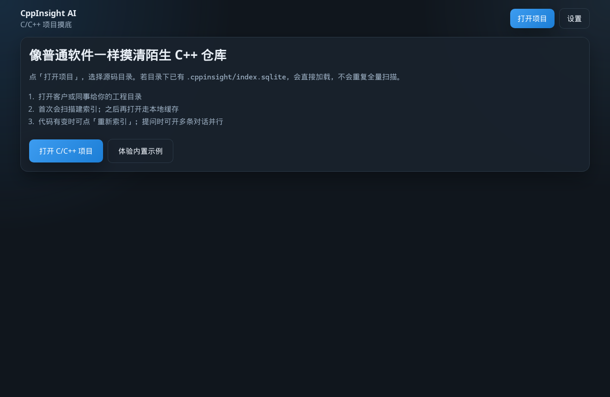
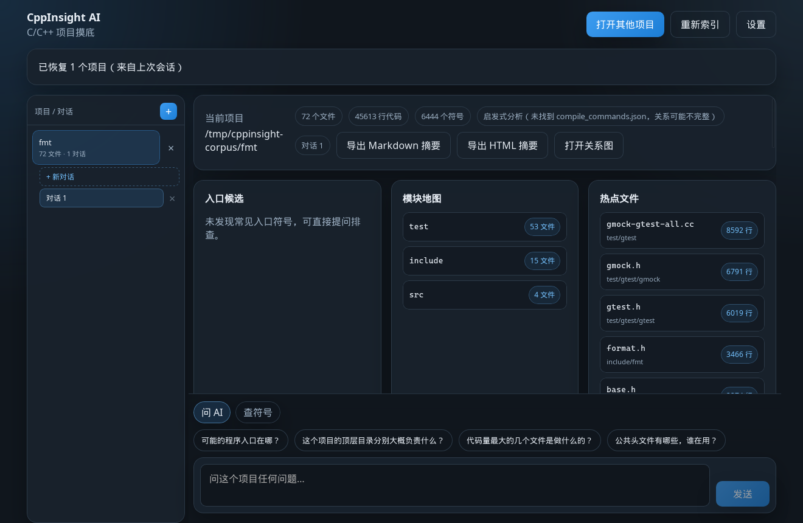
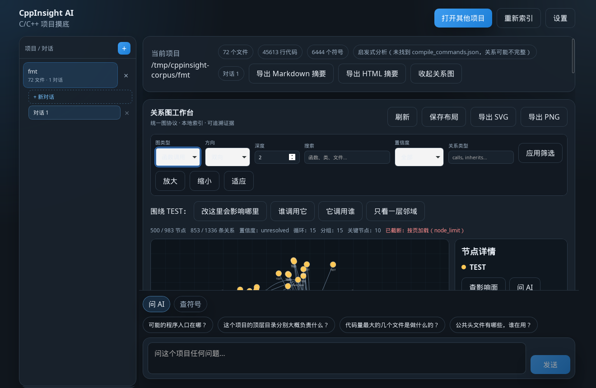
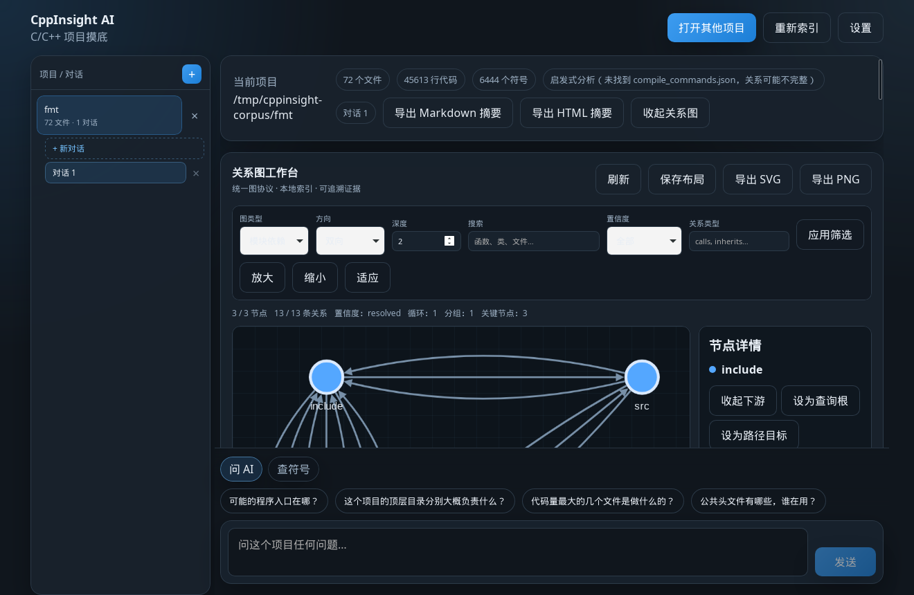
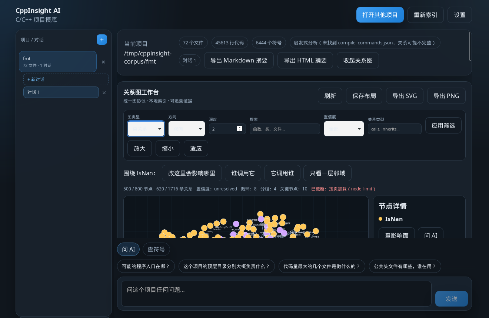
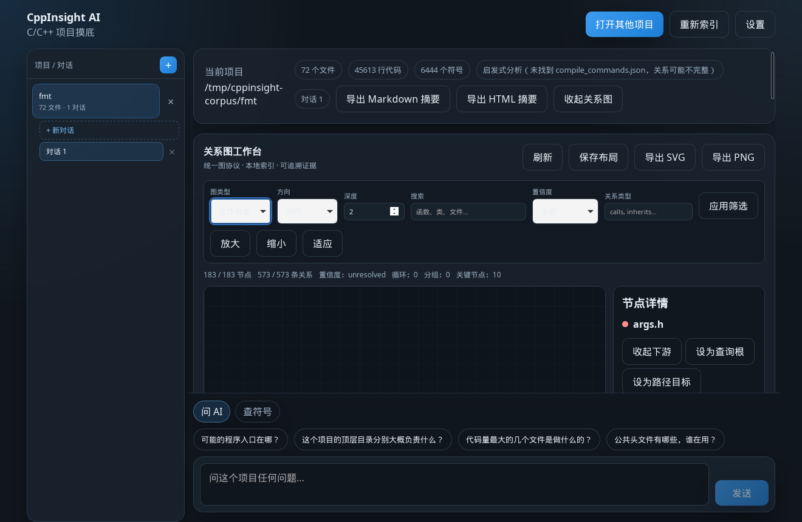
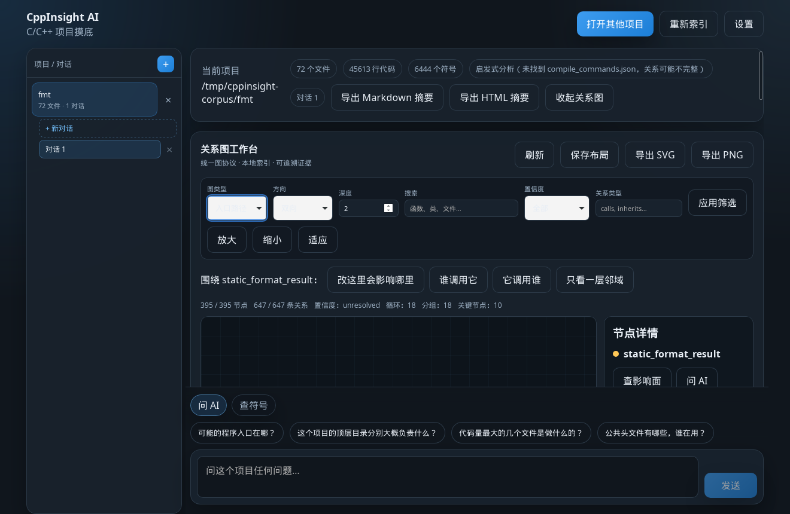
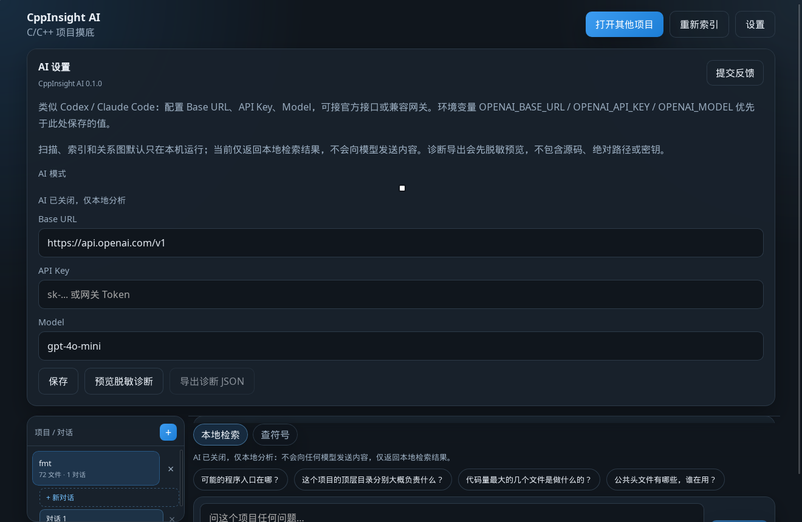

# CppInsight AI

[English](README.md)

[](LICENSE)
[](https://github.com/cluo-fast/cppinsight/actions/workflows/windows-ci.yml)

**面向不熟悉或遗留的 C/C++ 代码库的本地接手工具：启发式扫描、SQLite 索引、五类关系图，以及可以完全不联网的可选 AI。**

## 快速开始

编好扫描器，扫一遍仓库自带的示例。需要 CMake 3.16+ 和 C++17 编译器。示例本身只要几毫秒；耗时的是 Release 构建，在当前机器上仍然不到一分钟。

```bash
cmake -S . -B build -DCMAKE_BUILD_TYPE=Release
cmake --build build --config Release
./build/cppinsight scan examples/sample-cpp
```

Windows 多配置生成器的程序在 `build\Release\cppinsight.exe`。示例自带 `examples/sample-cpp/compile_commands.json`，所以这次扫描的模式是 `hybrid`。这仍然是按行/正则解析加上头文件搜索路径，不是编译器。fmt 12.2.1 和 protobuf 6.31.1 的计数以及人工核对样本见 [docs/demo.zh-CN.md](docs/demo.zh-CN.md)。

维护者在要发布的那次提交上用一条命令打 GitHub Release。这棵树里的版本号都是 `0.1.0`，所以标签是 `v0.1.0`。不打算发布就不要执行。Windows 的 MSI 和 NSIS 没有签名，SmartScreen 可能会警告。说明见 [docs/releasing-windows.md](docs/releasing-windows.md)。

```bash
git tag v0.1.0 && git push origin v0.1.0
```

## Windows 安装

[v0.1.0](https://github.com/cluo-fast/cppinsight/releases/tag/v0.1.0) 的 MSI 和 NSIS 没有签名。SmartScreen 常会显示 “Windows protected your PC”（中文系统多为「Windows 已保护你的电脑」）。点 **More info**（更多信息），再点 **Run anyway**（仍要运行）。运行前用该发布页上的 `SHA256SUMS.txt` 核对文件。未签名不等于已经做了 Authenticode 签名。

CppInsight AI 用来接手一套不是你写的 C/C++ 工程。它清点源码、在项目目录写入本地索引，并生成**项目接手报告**和可以回到引用行的**关系图**。它包含桌面应用、命令行和 MCP 服务。它不是编译器，也不是通用聊天客户端。

## 这不是 C++ Insights

[C++ Insights](https://cppinsights.io)（Andreas Fertig）用 Clang 展示编译器前端如何改写现代 C++：模板、lambda、range-for 等。**CppInsight AI 不做这件事。** 它不编译你的工程，也不输出编译器变换结果。名字相近，工具不同。想看编译器对一小段代码做了什么，用 C++ Insights；想给一套现成仓库画一张可核对的地图，用本项目。

## 为什么要有这个工具

很多 C/C++ 仓库交到手里时没有说明书：构建不完整、宏用了很多年、没人记得入口在哪个目录。逐个文件读很慢，把整棵树发给托管模型又往往不行。

CppInsight AI 把扫描、索引、报告和关系图留在本机。你可以先回答「从哪读起」和「谁调用了它」，再改代码。可选模型只在你确认文件和行号范围之后解释一小段引用。也可以关掉 AI，扫描、报告、关系图和符号查询仍然可用。

## 分析到底是什么

扫描器（`src/project/ProjectScanner.cpp`）是 C++17 **启发式**实现：遍历目录，用正则和按行扫描估计 include、符号、调用、类型关系和入口。它不构建 Clang AST，也不使用 libTooling。

`compile_commands.json` 是可选的，而且用途很窄。找到它时，加载器只收集头文件搜索路径，并记下编译数据库里列出了哪些文件。扫描模式于是成为 `hybrid`。这些文件里的符号和调用会被标成 `compile-db`。

**`compile-db` 不是编译器核对过，也不是 AST 级精确。** 它只表示该文件出现在编译数据库中，并且本地 include 按这些搜索路径做过解析。解析本身仍是按行/正则启发式。桌面筛选里同一取值显示为「编译数据库」。更早的索引和请求可能仍写 `precise`；读取时把它当作 `compile-db` 的旧别名。请回到证据行核对源码。

没有编译数据库时，模式和置信度保持 `heuristic`。宏、模板、`#if`、函数指针和虚调用都可能漏掉或连错。报告和图谱会故意留下这种不确定性。

## 功能

- **五类关系图**，桌面、Workbench CLI 和 MCP 共用一套协议：
  - 模块依赖
  - 函数调用
  - 类关系
  - 文件包含
  - 入口路径
- **影响面分析**：选中函数后查看直接/间接调用者、被调用者，以及一条短证据链。这是索引范围内的提示，不是「改这里一定安全」。
- **本地 SQLite 索引**，位于 `<项目>/.cppinsight/index.sqlite`。可按时间戳增量复用；重新索引可以取消，且不会破坏上一份完整索引。
- **可选 AI**，包含可持久化的仅本地模式。仅本地模式仍可扫描、出报告、看关系图，并从本地索引回答问题，不会请求模型。
- **CLI**（`cppinsight`）：扫描、总览和文字简报。
- **MCP 服务**（`tools/mcp-server`）：`cppinsight_inspect`、`cppinsight_ask`、`cppinsight_graph`，给本机上的代理使用。

桌面关系图工作台支持搜索、深度、方向、保存布局，以及导出 SVG/PNG。欢迎页可以「体验内置示例」（`examples/sample-cpp`），不必先准备自己的源码就能看到项目接手报告。

## 局限

- 启发式解析。不要把一条边当成编译器已经验证的事实。
- 编译数据库会改善 include 查找并改写保存下来的置信度标签，不会用编译器重新解析文件。
- fmt 12.2.1 和 protobuf 6.31.1 上有一份小的人工核对样本，见 [docs/demo.zh-CN.md](docs/demo.zh-CN.md)：核对 171 条，正确 153 条，错误 0 条，漏掉 18 条。样本里仍然发出的边，精确率是 1.000；这些行上真事实的召回率是 0.895。样本以外的边没有全部核对。这不是这两个仓库的准确率。
- 打包目标是 Windows 桌面（MSI/NSIS）。v0.1.0 安装包未签名，SmartScreen 可能拦截，需要点 More info（更多信息），再点 Run anyway（仍要运行）。见 [Windows 安装](#windows-安装)。
- Linux 和 macOS 可以编译扫描器以及大部分桌面代码，用于开发，不是发布目标。
- 没有关闭 AI 时，只有你确认过的摘录会发到你配置的 OpenAI 兼容端点。发送前请再看一眼范围。

## 构建、桌面和 MCP

文件顶部的三条命令会编好扫描器并扫描自带示例。这一节是桌面应用和 MCP。

### 扫描器（CMake）

需要 CMake 3.16+ 和 C++17 编译器。

```bash
cmake -S . -B build -DCMAKE_BUILD_TYPE=Release -DBUILD_TESTING=ON
cmake --build build --config Release
ctest --test-dir build -C Release --output-on-failure
```

Windows 多配置生成器的可执行文件在 `build\Release\cppinsight.exe`。Ninja / Make 等单配置生成器在 `build/cppinsight`。

```bash
./build/cppinsight scan examples/sample-cpp --json scan.json --overview overview.md
./build/cppinsight overview examples/sample-cpp --output overview.md
```

已有编译数据库时加上 `--compile-commands <file>`。要复用上一次扫描时加上 `--incremental <previous-json>`。

### 桌面

源码目录里的 Windows 启动器是 `启动CppInsight.bat`，也可以：

```powershell
.\scripts\start-desktop.ps1
```

从源码构建桌面需要 Rust（stable）、Node.js 22、pnpm 11.19，以及已经编好的扫描器：

```powershell
cd desktop
pnpm install --frozen-lockfile
pnpm run check
```

`pnpm run check` 会跑发布配置检查、前端生产构建、前端回归测试和 `cargo test`。打 NSIS/MSI 包请在仓库根目录运行 `.\scripts\package-app.ps1`。说明见 [desktop/README.md](desktop/README.md)。

首次索引完成后打开项目接手报告，再从报告进入关系图。设置里可以关闭 AI，状态会显示仅本地分析。

### Workbench CLI 与 MCP

```powershell
cargo build --release --manifest-path desktop\src-tauri\Cargo.toml --bin cppinsight-workbench
.\desktop\src-tauri\target\release\cppinsight-workbench.exe inspect --root D:\path\to\project encryptFile
```

MCP 配置见 [tools/mcp-server/README.md](tools/mcp-server/README.md)。协议见 [docs/graph-protocol-v1.md](docs/graph-protocol-v1.md)。

## 隐私

扫描、索引、关系图和影响面查询都在本机完成。如果设置了 API Key，它进入操作系统凭据库（Windows Credential Manager，macOS 上为 Keychain），不写入项目 SQLite，也不返回给网页视图。诊断导出是一份汇总预览：版本、平台、匿名项目 ID 和计数。里面没有源码、路径、聊天记录或密钥。

环境变量 `OPENAI_BASE_URL`、`OPENAI_API_KEY`、`OPENAI_MODEL` 优先于桌面里保存的值。

## 截图

下面这些图是在 Linux 上用 Xvfb 截的 Tauri 调试构建，数据是 fmt 12.2.1 的启发式索引（`208219daff58f2a7438f6931cc2ddc358acf33ef`，没有 `compile_commands.json`）。不是 Windows 安装包。索引后的项目栏写着启发式分析，并且没有找到编译数据库。图上的边没有经过编译器核对。命令行录屏见 [docs/screenshots/cli-scan.gif](docs/screenshots/cli-scan.gif)。



欢迎页。能看到「体验内置示例」和打开项目。



索引之后的 fmt：72 个文件、45613 行代码、6444 个符号。项目接手报告（`02-onboarding-report.png`）在更下面的内部滚动区域里。这次 Xvfb 会话的滚轮事件没有滚动那个区域，所以这个文件不在仓库里。



函数调用图。这一帧的状态行是 983 个节点里的 500 个、1336 条边里的 853 条，因 `node_limit` 截断，置信度汇总是 `unresolved`。影响面按钮能看见；影响面结果列表没有打开（没有 `08-impact.png`）。



模块依赖：3/3 个节点、13/13 条边（`include` 和 `src`）。状态行把这些边的置信度汇总写成 `resolved`。同一屏的项目栏仍然写着启发式扫描。这里的 `resolved` 是图汇总标签，不是编译器核对。



类关系：800 个节点里的 500 个、1716 条边里的 620 条，因 `node_limit` 截断。



文件包含。状态行是 183/183 个节点、573/573 条边，置信度汇总 `unresolved`，选中了 `args.h`。这一帧的画布里节点没有大到能读清。



入口路径。状态行是 395/395 个节点、647/647 条边。选中的名字是 `static_format_result`。不少绘制落在初始视口外面。



设置里关掉了 AI。文案是仅本地分析，隐私说明写的是只返回本地检索、不会把内容发给模型。

没有截到：`08-impact.png`（影响面结果列表）和 `09-source-preview.png`（从证据行打开的源码预览）。函数调用那张图上有打开它们的按钮。这次点击没有在画面里留下单独的面板。

## 项目状态

源码可以构建，也有自动测试（Windows CI 会跑扫描器、前端、Rust、MCP、安装包烟测和示例图基准）。它还不是已签名的公开下载包。[docs/demo.zh-CN.md](docs/demo.zh-CN.md) 里的人工样本不是百万行规模的测量。Authenticode 还没有。计划中的两张截图没有拍到：影响面结果列表和源码预览。发布清单见 [docs/public-beta-readiness.md](docs/public-beta-readiness.md)。

## 许可证

扫描器、测试、桌面应用、CLI、MCP 服务、示例和文档同为 Apache-2.0。见 [LICENSE](LICENSE)、[NOTICE](NOTICE)、[THIRD_PARTY_NOTICES](THIRD_PARTY_NOTICES) 和 [docs/licensing.md](docs/licensing.md)。

## 参与贡献

欢迎 Issue 和 Pull Request。提交改动前请读 [CONTRIBUTING.md](CONTRIBUTING.md)。报告缺陷时使用 GitHub 表单，不要粘贴客户源码、索引、绝对路径或 API Key。需要环境信息时，附上设置页导出的脱敏诊断。
